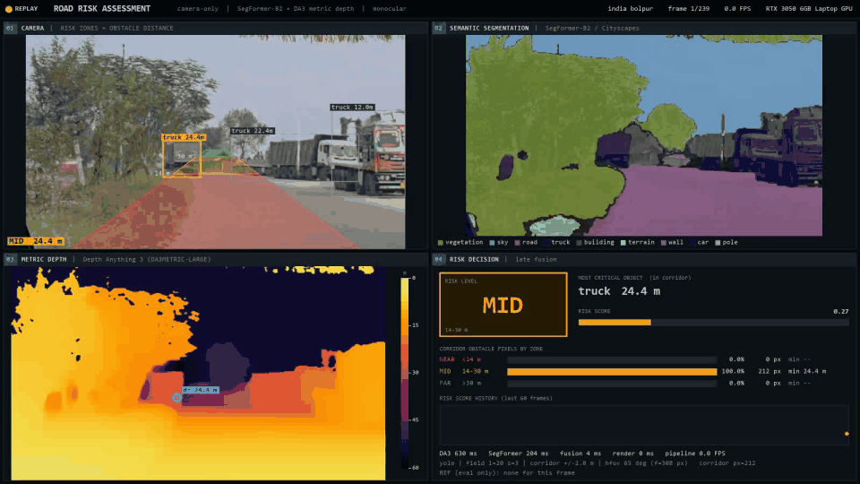
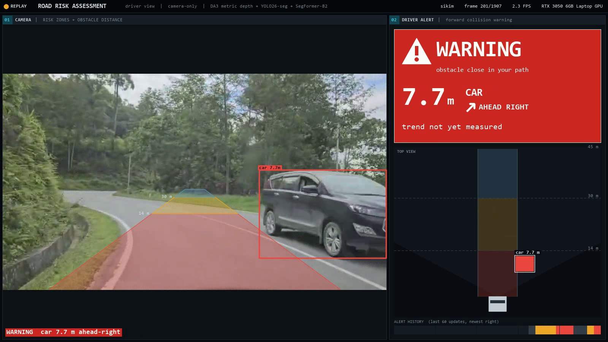
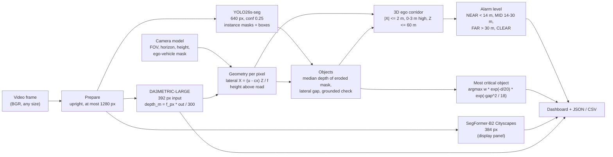
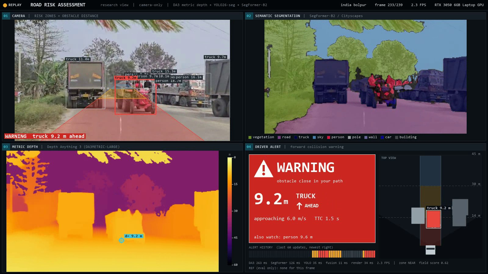
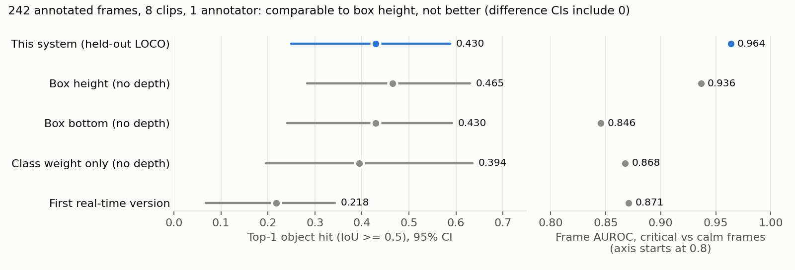
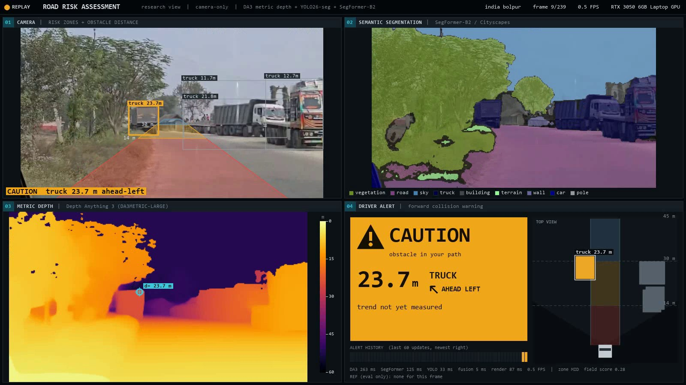
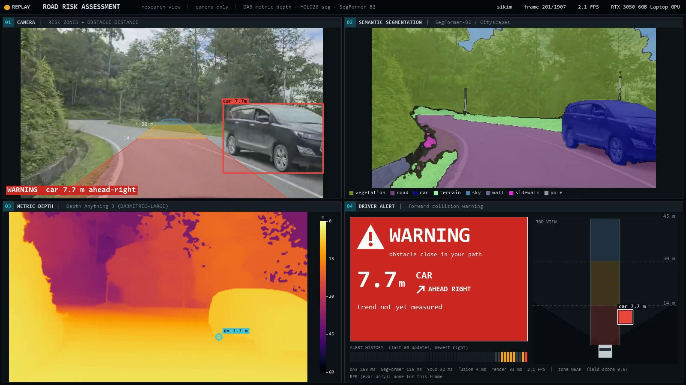
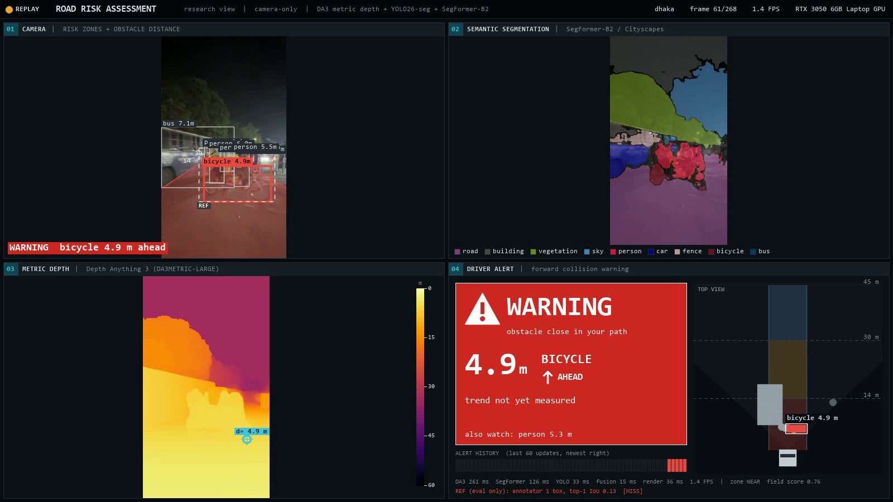
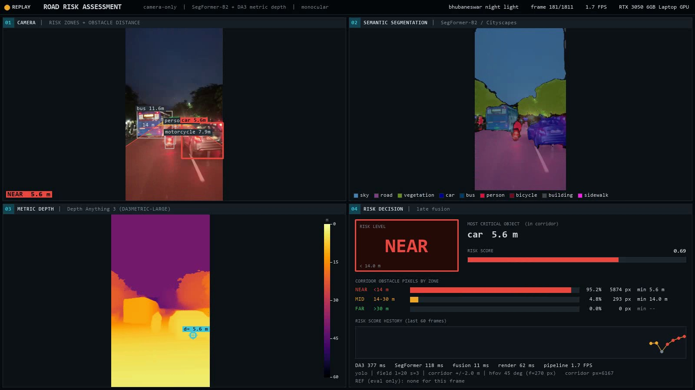
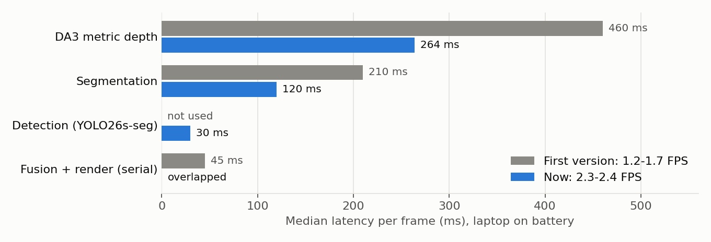

# Real-time Road Risk Assessment from a Single Camera

**Metric depth + instance segmentation + semantic segmentation, fused into an interpretable risk decision, live on a 6 GB laptop GPU.**

Author: **Pritam Chakraborty** (pritam.23.research@gmail.com) · Licence: [AGPL-3.0-or-later](LICENSE)



One camera frame in. Out come:
- distances in metres to every road user;
- a driver alert (**WARNING / CAUTION / CLEAR**) with the object, its bearing, its approach speed and its time to collision;
- the single **most critical object**;
- a dashboard in one of two layouts.

| View | Panels |
|---|---|
| `--view research` (default) | 01 camera with the projected ego corridor and per-object distances · 02 SegFormer-B2 segmentation · 03 metric depth (0-60 m) · 04 **driver alert** with a top view and alert history, plus one grey line of research metrics |
| `--view driver` | the camera, large, and the **driver alert** column only: what an in-vehicle display would show |



---

## Contents

1. [How it works](#how-it-works)
2. [Install](#install)
3. [Run it on a video](#run-it-on-a-video)
4. [Run it on a single frame](#run-it-on-a-single-frame) (command line, Python API, JSON output)
5. [Driver alert interface](#driver-alert-interface)
6. [Camera assumptions](#camera-assumptions-read-before-trusting-a-distance)
7. [Configuration](#configuration)
8. [Results](#results)
9. [Speed](#speed)
10. [Reproducing the evaluation](#reproducing-the-evaluation)
11. [Limitations](#limitations)
12. [Repository layout](#repository-layout) · [Data layout](#data-layout) · [Licence](#licence) · [Citation](#citation)

---

## How it works



**1. Perception (GPU).** Three models run on every frame:
- **Depth Anything 3 Metric-Large** (DA3METRIC-LARGE) predicts depth that becomes metres once multiplied by the focal length in pixels:
  `depth_m = f_px * output / 300`.
- **YOLO26s-seg** finds road users (person, bicycle, car, motorcycle, bus, truck, animals) as instance masks.
- **SegFormer-B2** labels every pixel with one of 19 Cityscapes classes for the segmentation panel. Its own obstacle regions were
  tested as an object source and were clearly worse than YOLO instances (see [Results](#results)).

**2. Geometry.** A pinhole camera with zero pitch: the principal point sits at the image centre column and an assumed horizon row.
Every pixel `(u, v)` with depth `Z` gets a lateral offset `X = (u - cx) * Z / f` and a height above a flat road
`h_cam - (v - cy) * Z / f`. The **ego corridor** is the 3D box |X| <= 2 m, 0 to 3 m above the road, Z <= 60 m.

**3. Objects.** For each detection:
- its distance `d` is the median depth over its mask, eroded by one pixel so depth bleeding at the edges is dropped;
- its lateral `gap` is how far it sits outside the corridor;
- it only counts for the corridor if it is **grounded**, i.e. its lowest pixel is below the horizon. This rejects blobs in the sky
  or on the recording car's own pillars.

**4. Decision.**
- **Alarm level:** the nearest distance zone holding at least 25 in-corridor obstacle pixels; the distance is the 1st percentile of
  those pixels' depths.
- **Most critical object:** argmax over all objects of `w_class * exp(-d / λ) * exp(-gap² / (2σ²))` with λ = 20 m and σ = 3 m. Class weights:
  person 1.3, car and truck 1.2, bicycle, motorcycle and rider 1.1, bus 1.0, animals 0.5. Its value is the frame's **risk score** (0 to 1).
  The rule and its parameters were chosen by leave-one-clip-out evaluation, not by hand ([Results](#results)).

**5. Pipeline.** A GPU thread runs the models on frame t+1 while the main thread fuses, draws and shows frame t. In live mode
the source plays at its native frame rate and the newest frame is always processed, so the display keeps up with wall-clock time.

| Bad corridor without the safeguards | What fixes it |
|---|---|
| Dash cams see their own hood and A-pillar; both were detected as objects at 2-3 m | per-video `ego_mask` polygons (config) + the grounded check + the 3 m height cap |
| Low-confidence segmentation blobs at frame edges | pixels below softmax 0.6 are ignored |
| Depth bleeding across object boundaries | 1-pixel mask erosion, median / low-percentile distances |

---

## Install

Requirements: Python 3.10+ (tested on 3.12), an NVIDIA GPU with at least 6 GB (tested: RTX 3050 6 GB Laptop, CUDA 12.1).
It runs on CPU too, but far below real time.

```bash
git clone https://github.com/Pritamresearch/realtime-road-risk.git
cd realtime-road-risk

python -m venv .venv
# Windows: .venv\Scripts\activate      Linux/macOS: source .venv/bin/activate
pip install -r requirements.txt

# Depth Anything 3 from source (its own requirements are heavier than needed for inference)
git clone --depth 1 https://github.com/ByteDance-Seed/depth-anything-3 third_party/depth-anything-3
pip install --no-deps -e third_party/depth-anything-3
pip install addict moviepy==1.0.3 trimesh imageio plyfile pycolmap evo tqdm

# Model weights (~1.5 GB) into weights/
python download_weights.py
```

`weights/` then holds `da3metric-large/`, `segformer-b2-cityscapes/` and `yolo26s-seg.pt`. SegFormer ships a `.bin` checkpoint; it is
converted to safetensors on first load, because transformers 4.x refuses `torch.load` on torch < 2.6.

---

## Run it on a video

```bash
python run.py path/to/drive.mp4                          # live: plays at native speed, processes the newest frame
python run.py path/to/drive.mp4 --view driver            # in-vehicle layout: camera + driver alert only
python run.py 0                                          # webcam 0
python run.py path/to/drive.mp4 --mode all               # every frame (slower than real time, nothing skipped)
python run.py path/to/drive.mp4 --mode all --every 5     # every 5th frame
python run.py path/to/drive.mp4 --save out/drive_dashboard.mp4 --log out/drive.csv
python run.py path/to/drive.mp4 --hfov-deg 70 --horizon 0.48 --height-m 1.4   # your camera
python run.py path/to/drive.mp4 --hq                     # larger model inputs, ~1.5x slower
python run.py path/to/images/                            # a folder of frames, in name order
python run.py sikim                                      # part of a file name in data/videos/
```

Keys in the window: `q` / `Esc` quit, `space` pause, `s` save a screenshot to `out/`. `--no-window` runs headless (with `--save`/`--log`).
Phone videos with rotation metadata are turned upright automatically.

`--log` writes one CSV row per processed frame:

| column | meaning |
|---|---|
| `frame` | 1-based frame number in the source |
| `alert`, `alert_object`, `ttc_s`, `closing_mps` | driver alert state (after hysteresis), the object it is about, time to collision and closing speed when measured |
| `level`, `distance_m` | corridor zone (NEAR / MID / FAR / CLEAR) and the corridor distance behind it |
| `top`, `top_distance_m`, `score` | most critical object, its distance, the frame risk score |
| `near_px`, `mid_px`, `far_px`, `corridor_px` | in-corridor obstacle pixels per zone |
| `t_depth_ms`, `t_seg_ms`, `t_det_ms`, `t_fusion_ms` | per-stage latency |

---

## Run it on a single frame

### Command line

```bash
python predict_frame.py frame.jpg                        # -> out/frame_dashboard.png and out/frame.json
python predict_frame.py a.jpg b.png c.jpg --out results/ # several frames, models loaded once
python predict_frame.py drive.mp4 --frame 120            # frame 120 (1-based) of a video
python predict_frame.py frame.jpg --hfov-deg 70 --horizon 0.48 --height-m 1.4
```

Console output:

```
frame.jpg: WARNING (zone NEAR at 3.43 m), most critical: person 3.85 m  -> out/frame_dashboard.png
```

`out/frame.json` (abridged):

```json
{
  "alert": {
    "state": "WARNING", "raw_state": "WARNING", "object": "person", "distance_m": 3.41, "bearing": "AHEAD",
    "trend": "unknown", "closing_speed_mps": null, "ttc_s": null, "reason": "corridor zone NEAR", "watch": null, "held_s": null
  },
  "level": "NEAR",
  "level_distance_m": 3.43,
  "risk_score": 0.8249,
  "most_critical": {
    "class": "person",
    "distance_m": 3.85,
    "corridor_distance_m": 3.41,
    "lateral_gap_m": 0.0,
    "field_score": 0.8249,
    "box_xyxy_frac": [0.8472, 0.5164, 1.0, 0.8484]
  },
  "zones": {"NEAR": {"pixels": 2795, "min_m": 3.43}, "MID": {"pixels": 80, "min_m": 14.6}, "FAR": {"pixels": 0, "min_m": null}},
  "objects": [{"class": "person", "distance_m": 3.85, "...": "..."}],
  "camera": {"hfov_deg": 45.0, "horizon": 0.5, "height_m": 1.3, "f_px": 270.4},
  "timings_ms": {"depth": 640.5, "seg": 208.6, "det": 487.8, "fusion": 4.2}
}
```

Boxes are fractions of the frame width and height (`x0, y0, x1, y1`). `corridor_distance_m` is `null` when the object never enters the
corridor. A single image has no motion, so `trend` is `unknown` and there is no TTC; pass a time `t` per frame (below) to get them. These timings are from a single frame and include GPU warm-up; in a video the steady state is about 264 / 120 / 30 ms.

### Python API

```python
import cv2
from pipeline import RiskPipeline

pipe = RiskPipeline()                                   # loads the three models once
# pipe = RiskPipeline(camera={"hfov_deg": 70, "horizon": 0.48, "height_m": 1.4})   # calibrated camera

frame = cv2.imread("frame.jpg")                         # any BGR frame, e.g. from cv2.VideoCapture
result = pipe(frame)                                    # perceive (GPU) + decide (fusion) + driver alert

a = result.alert
print(a.state, a.obj.name if a.obj else None, a.distance, a.bearing)   # 'WARNING' 'person' 3.41 'AHEAD'
d = result.decision
print(d.level, d.distance, d.score)                     # 'NEAR' 3.43 0.82
if d.top:
    print(d.top.name, d.top.distance, d.top.gap_m)      # 'person' 3.85 0.0
depth_m = result.perception.depth                       # HxW metric depth (392-px grid)
summary = result.to_dict()                              # the JSON above
dashboard = pipe.render(result)                         # RGB uint8, 1600x900
cv2.imwrite("dashboard.png", cv2.cvtColor(dashboard, cv2.COLOR_RGB2BGR))
```

For a video, pass each frame's time in seconds so the alert can track objects, estimate approach speed and TTC, and apply hysteresis:

```python
cap = cv2.VideoCapture("drive.mp4")
fps, n = cap.get(cv2.CAP_PROP_FPS), 0
pipe = RiskPipeline(view="driver")
while True:
    ok, frame = cap.read()
    if not ok:
        break
    n += 1
    if n % 10:                                          # e.g. every 10th frame
        continue
    result = pipe(frame, t=n / fps)
    a = result.alert
    if a.state != "CLEAR":
        print(f"{n / fps:6.1f} s  {a.state}  {a.obj.name} {a.distance:.1f} m {a.bearing}  "
              f"{a.trend.label}" + (f", TTC {a.trend.ttc_s:.1f} s" if a.trend.ttc_s else ""))
```

To overlap GPU and drawing, call `pipe.perceive(frame, t=...)` on a worker thread and `pipe.decide(perception)` on the consumer side,
as `run.py` does.

---

## Driver alert interface

The first dashboard showed a research readout: zone labels (a green "FAR" for a truck in the lane), pixel counts, a score bar and model
timings. None of that tells a driver what to do. The alert panel now follows the usual forward-collision-warning conventions:

| Element | Design |
|---|---|
| **State** | one of three, each shown as colour + icon + word, never colour alone: **WARNING** (red fill, triangle), **CAUTION** (amber fill, triangle), **CLEAR** (neutral, check mark). Nothing on the road ahead is ever shown as "safe green". |
| **What and where** | the object in your path, its distance in large type, and a bearing arrow: AHEAD, AHEAD-LEFT / AHEAD-RIGHT (in the corridor but off-centre), LEFT / RIGHT (outside it) |
| **Trend** | approaching / moving away with the closing speed, plus **TTC** (time to collision) for objects in your path. When there is not enough data the panel says "trend not yet measured" rather than "steady". |
| **CLEAR state** | quiet: "no obstacle in your path" and the nearest road user on one small line, no headline numbers |
| **Hysteresis** | a higher state appears at once; a lower one only after holding 1 s. While held, the card says "last seen 0.7 s ago: car 7.7 m" instead of showing stale numbers as live. |
| **Also watch** | when the risk field's most critical object (e.g. a pedestrian at the kerb) is not the one in your path, it is named on a secondary line |
| **Top view** | metres: your car at the bottom, the ±2 m corridor shaded by zone, 14 m and 30 m lines, the camera's field of view, every road user at its (X, Z) position (lateral scale stretched for readability) |
| **Alert history** | the last 60 alert states as a strip, so recent escalations stay visible |



**How the state is decided** (`hmi.py`, thresholds in `config.yaml` under `hmi`):
- NEAR zone in the corridor → WARNING, MID zone → CAUTION, otherwise CLEAR.
- An object in the corridor that is approaching with TTC < 2 s escalates to WARNING; TTC < 4 s escalates to at least CAUTION.
- **Trend:** objects are tracked across frames by box overlap within a class. A line is fitted to each track's distance over the last
  3 s. A trend is reported only when the slope exceeds both 0.5 m/s and twice its standard error. Monocular depth jitters by a few
  percent per frame, so without this test TTC would be noise.
- **TTC** = distance / closing speed. It is relative (no ego speed needed) and shown only for objects in your path: beside the path,
  closing speed mostly reflects your own motion past a parked object.

The TTC escalation and the hysteresis are **not part of the evaluated system** (no ground truth for them here). The reported results
cover the zone alarm and the most critical object; the alert layer is a display policy on top.

---

## Camera assumptions (read before trusting a distance)

Monocular metric depth needs the focal length. Without calibration it is derived from an **assumed horizontal field of view**:
65 deg for landscape dash cams (BDD100K is about 65 deg), 45 deg for upright phones. **Distances scale linearly with the focal length**,
so a 10% FOV error is roughly a 10% distance error. The corridor overlay and the height test also assume zero pitch, a horizon row
(default mid-image) and a camera height (1.5 m).

Set the real values when you know them:
- per run: `--hfov-deg`, `--horizon`, `--height-m` (or the `camera=` argument of `RiskPipeline`);
- per video: `config.yaml`, under `camera.per_source.<file stem>`.

From a calibration matrix: `hfov_deg = 2 * atan(width / (2 * fx))`. For example, nuScenes CAM_FRONT (fx = 1266 at 1600 px) is about 64.6 deg.

**Ego-vehicle mask.** If the camera sees its own hood, dashboard or pillars, draw them as polygons (fractions of the frame), e.g.

```yaml
camera:
  per_source:
    my_drive:                       # file stem of the video
      hfov_deg: 65.0
      horizon: 0.47
      ego_mask:
        - [[0.0, 0.78], [1.0, 0.76], [1.0, 1.0], [0.0, 1.0]]                                   # hood
        - [[0.75, 0.0], [1.0, 0.0], [1.0, 0.74], [0.93, 0.46], [0.84, 0.21]]                   # right A-pillar
```

---

## Configuration

Everything lives in [`config.yaml`](config.yaml):

| key | default | meaning |
|---|---|---|
| `models.depth_process_res` | 392 | DA3 input (long side); `--hq` uses 504 |
| `models.segformer_short_side` | 384 | segmentation panel resolution; `--hq` uses 512 |
| `risk.source` | `yolo` | object candidates: `yolo` instances or `seg` (SegFormer components) |
| `risk.yolo_conf` | 0.25 | detection threshold |
| `risk.class_weights` | see file | per-class importance `w` |
| `risk.rule` | `field` | `field` (argmax of the risk field) or `corridor` (nearest in-corridor object) |
| `risk.field_lambda_m`, `risk.field_sigma_m` | 20, 3 | distance and lateral fall-off of the risk field |
| `risk.dist_q` | 50 | percentile of an object's depths used as its distance |
| `risk.corridor_half_width_m` | 2.0 | ego corridor half width |
| `risk.near_m`, `risk.mid_m`, `risk.max_range_m` | 14, 30, 60 | zone limits |
| `risk.max_height_m` | 3.0 | corridor height above the road |
| `risk.min_px`, `risk.quantile`, `risk.erode` | 25, 1, 1 | alarm guards: pixels per zone, distance percentile, mask erosion |
| `camera.default` / `camera.portrait` | 65 deg / 45 deg | FOV, horizon, camera height presets |
| `hmi.ttc_warning_s`, `hmi.ttc_caution_s` | 2.0, 4.0 | TTC escalation thresholds |
| `hmi.hold_s` | 1.0 | hysteresis before a lower alert state is shown |
| `hmi.window_s`, `hmi.min_samples`, `hmi.min_speed_mps` | 3.0, 3, 0.5 | trend fit window and significance floor |

---

## Results

Evaluated on **242 annotated frames from 8 driving clips**: six own recordings (Bolpur, Sikkim, Dhaka day and night, Bhubaneswar night, Malaysia), one BDD100K video and one public highway video:
- 142 frames carry human boxes around what the driver *must attend to*;
- 100 frames are marked "nothing safety-critical";
- one annotator.

**What was compared**
- 120 fusion variants (object source, class set, selection rule, lambda, sigma, distance percentile) were fixed in
  [`eval_grid.yaml`](eval_grid.yaml) **before** scoring.
- The setting was chosen by **leave-one-clip-out** (LOCO), so the main number is always measured on a clip the selection never saw.
- Intervals are a two-stage bootstrap (clips, then frames), 2,000 draws.



| Method | Top-1 object hit [95% CI] | Minus box height | Frame AUROC |
|---|---|---|---|
| **This system, LOCO-selected (held out)** | **0.430** [0.250, 0.588] | -0.035 [-0.119, +0.023] | **0.964** |
| Box height heuristic (YOLO, no depth) | 0.465 [0.283, 0.630] | | 0.936 |
| Box bottom heuristic (YOLO, no depth) | 0.430 [0.241, 0.592] | -0.035 [-0.117, +0.014] | 0.846 |
| Class weight only (YOLO, no depth) | 0.394 [0.196, 0.636] | -0.070 [-0.158, +0.071] | 0.868 |
| First real-time version (SegFormer regions, nearest in corridor) | 0.218 [0.068, 0.343] | -0.246 [-0.370, -0.146] | 0.871 |

- **Top-1 object hit:** the most critical object's box has IoU >= 0.5 with a human box.
- **Frame AUROC:** how well the frame risk score separates critical frames from nothing-critical ones.

**How to read this honestly**
- Switching the object source from segmentation regions to YOLO instances, plus the risk-field rule, **doubled** the object match (0.218 to 0.430).
- The system is **comparable to, not better than**, the depth-free box-height heuristic:
  - object match difference -0.035 [-0.119, +0.023];
  - AUROC difference +0.027 [-0.029, +0.108].

  Both intervals include zero.
- The selection was stable: 6 of 8 folds picked the same setting, which is the shipped default.
- **Alarm:** NEAR or MID fires on 86% of the critical frames and on 10% of the nothing-critical frames.
- **Depth resolution:** 392 px scored the same as 504 px (top-1 0.444 vs 0.430, AUROC 0.963 vs 0.964), hence the faster default.
- **Ceiling:** in 37% of boxed frames no variant can hit at all: classes the detector lacks (cycle-rickshaws), tiny objects, loose boxes.
- **What depth adds is interpretability** (metres, a metric corridor, NEAR/MID/FAR), not a measured accuracy gain on these labels.
  The metre values themselves are not validated here, because no lidar ground truth was available.

Full tables and per-fold choices: [`docs/eval_results.md`](docs/eval_results.md).

### Examples (own clips)

| | |
|---|---|
|  |  |
| **Bolpur:** a parked truck 23.7 m ahead-left reaches the corridor: CAUTION. The trucks on the right are outside the path and only labelled. | **Sikkim, a failure mode:** on a curve, an oncoming car in its own lane falls inside the *straight* corridor: WARNING at 7.7 m ahead-right. |
|  |  |
| **Dhaka (phone, portrait), a missing class:** the cycle-rickshaw ahead is detected as a *bicycle* at 4.9 m (WARNING) and its rider as a *person* ("also watch"). The annotator boxed the whole rickshaw, so the eval line reads MISS (IoU 0.13): COCO and Cityscapes have no rickshaw class. | **Bhubaneswar at night:** a car 5.6 m ahead in the corridor: WARNING. The bus and the motorcycle are placed in the top view with their distances. |

---

## Speed

All numbers are measured on an **RTX 3050 6 GB Laptop GPU running on battery**: the GPU was capped at 35 W and 1177 of 2100 MHz,
fp16 matmul 2.9 TFLOPS. Plugged in, expect noticeably more.



| Stage | First version | Now | What changed |
|---|---|---|---|
| DA3 depth | ~460 ms (official API, 504 px) | 264 ms (392 px) | direct forward pass; backbone weights kept in bf16 (removes ~40 ms of per-frame autocast recasting); position-embedding interpolation cached (~45 ms of bicubic per frame); 392 px input. DA3's exact two-step resize is kept: collapsing it shifted depth ~2%. The bf16 backbone changes depth by 0.1-0.3% (median) vs the official API. |
| Segmentation | 210 ms (decision + display) | 120 ms (display only, 384 px) | YOLO instances took over the decision |
| Detection | none | 30 ms | YOLO26s-seg, fp16 |
| Fusion + render | ~45 ms, serial | ~5 + ~40 ms, overlapped | two-stage pipeline (GPU thread + display thread) |
| **Pipeline** | **1.2-1.7 FPS** | **2.3-2.4 FPS** | `--hq`: 1.5 FPS |

Not done yet: TensorRT / ONNX export, `torch.compile` (no Triton on Windows), INT8.

---

## Reproducing the evaluation

Needs the annotated clips in `data/` (see [Data layout](#data-layout)); they are not part of the repository.

```bash
python eval_cache.py      # all models once on the 242 annotated frames -> cache/eval/ (~5 min)
python evaluate.py        # 120 pre-declared variants, LOCO selection, bootstrap -> out/eval_results.md, out/eval_frames*.csv
python make_figures.py    # docs/results.png, docs/timings.png
python run.py sikim --annotated      # live view of the annotated frames with an eval-only MATCH/MISS line
```

---

## Limitations

- **Distances are assumption-bound:** an uncalibrated FOV, a flat road, zero pitch and a fixed camera height. They have not been checked
  against lidar.
- **The corridor is straight ahead:** no steering, lane curvature or ego speed. On curves, oncoming traffic in its own lane can enter
  the straight corridor (see the Sikkim example).
- **TTC is unvalidated:** it comes from simple box tracking at about 2.4 FPS. Fast crossing objects can lose their track, and the
  significance test then suppresses the trend.
- **The labels are thin:** one annotator, 8 clips. The labels mark attention-worthy objects, not measured collision risk.
- **Classes are missing:** COCO/Cityscapes have no cycle-rickshaw or auto-rickshaw, and these are frequent in South Asian traffic.
- **Dash cams need care:** a camera that sees its own vehicle needs an ego mask.
- **Speed:** about 2.4 FPS is "real time" only for slow-changing scenes. A deployable system would need an optimised runtime and a faster GPU.

---

## Repository layout

```
run.py              live app: video / webcam / image folder -> dashboard window, mp4, CSV
predict_frame.py    single frames -> dashboard PNG + decision JSON
pipeline.py         RiskPipeline: perceive (GPU) + decide (fusion) + render; the Python API
models.py           DA3 metric depth (fast path), SegFormer-B2, YOLO26s-seg wrappers
risk.py             geometry, corridor, objects, alarm level, risk field
hmi.py              driver alert: tracking, trend, TTC, hysteresis
dashboard.py        research and driver layouts: camera, segmentation, depth, alert card, top view (OpenCV shapes, PIL text)
viewer.py           Tk window (works with opencv-python-headless)
sources.py          video (rotation-aware), webcam, images, BDD-OIA; optional reference labels
datasets.py         loaders for the annotated clips and BDD-OIA (local data/)
config.yaml         models, camera presets, risk and alert parameters
download_weights.py model checkpoints -> weights/
eval_clips.yaml     the 8 evaluation clips (annotation file -> video)
eval_cache.py, evaluate.py, eval_grid.yaml, make_figures.py, summarize_eval.py    evaluation
docs/               figures, screenshots, evaluation summary
LICENSE             GNU AGPL-3.0
THIRD_PARTY_NOTICES.md   model, library and data licences
```

Created locally and git-ignored: `weights/`, `third_party/` (Depth Anything 3 source), `data/`, `cache/`, `out/`.

## Data layout

Only needed for the evaluation, the `--annotated` reference line and BDD-OIA browsing; the pipeline itself needs nothing in `data/`.

```
data/
  videos/                  the clips named in eval_clips.yaml (e.g. sikim.mp4, bdd100k/00a0f008-3c67908e.mov)
  annotations/<clip>.csv   one file per clip
  bdd_oia/lastframe/       BDD-OIA release: {train,val,test}_25k_images_actions.json, data/*.jpg
```

An annotation file starts with `# key: value` header lines, of which `size: WxH` (the upright full-size frame) is required, followed by
CSV rows `frame,x0,y0,x1,y1,none`:
- `frame` is a 1-based video frame number;
- boxes are pixels of the upright frame;
- `none=1` marks a frame judged to have nothing safety-critical;
- a frame can have several box rows.

To evaluate on your own clips, add them to `eval_clips.yaml` with an annotation file each.

## Licence

Copyright (C) 2026 Pritam Chakraborty.

This program is free software: you can redistribute it and/or modify it under the terms of the **GNU Affero General Public License**
as published by the Free Software Foundation, either version 3 of the License, or (at your option) any later version. It is
distributed WITHOUT ANY WARRANTY. See [`LICENSE`](LICENSE).

**Why AGPL-3.0:** the pipeline depends on Ultralytics YOLO26, which is AGPL-3.0, so the combined work is distributed under the same
licence. If you run a modified version as a network service, the AGPL requires you to offer its source to the users of that service.

**Model weights keep their own licences** and are not redistributed here. Depth Anything 3 Metric-Large is Apache-2.0. YOLO26s-seg is
AGPL-3.0. SegFormer-B2 Cityscapes is **non-commercial** (NVIDIA SegFormer licence). Details are in
[`THIRD_PARTY_NOTICES.md`](THIRD_PARTY_NOTICES.md).

The screenshots and the GIF come from the author's own recordings. No BDD100K, BDD-OIA or KITTI images are included.

## Citation

```bibtex
@software{chakraborty_realtime_road_risk,
  author = {Chakraborty, Pritam},
  title  = {Real-time Road Risk Assessment from a Single Camera: Metric Depth and Instance Segmentation with Late Fusion},
  year   = {2026},
  license = {AGPL-3.0-or-later},
  note   = {pritam.23.research@gmail.com}
}
```
